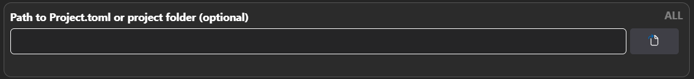

# File Picker

When selecting files in CodeGlass (for example, a Project.toml file), you will see a button next to the input field. Pressing this button sends a message to the [Engine](../intro#engine) to open a file picker.

The reason CodeGlass opens the file picker from the Engine is that the [Client](../intro#client) cannot access the full path of a file, while the Engine needs the full path. This approach does, however, come with some limitations.

:::info
The file picker opens on the computer where the Engine is running. This means that when using a [remote connection](../views/general/settings#serve-client-over-https), you cannot use the file picker.
:::

### MacOS

On macOS, CodeGlass uses osascript to open the file picker, so there should be no issues here.

### Linux

Because Linux does not have a standard file picker, CodeGlass uses the XDG Desktop Portal to open one. This is not supported by every distribution, but you can check which distributions support it [here](https://wiki.archlinux.org/title/XDG_Desktop_Portal).

### Windows

Because the Engine has no UI, the file picker will most likely open in the background. When the message indicating that the file picker is open is displayed, you will need to press Alt+Tab to switch to the file picker.