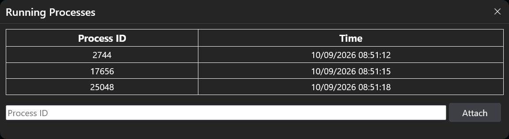

# Attach To Running .NET Process

We have experimental support for attaching the [CodeGlass Agent](../../intro#agent) to a running .NET process. This means you can start profiling the instance even after you've started it without CodeGlass.

On the [Instance List](../../views/general/instance-list) screen, .NET applications will have a button that allows you to attach to a running process of the application you are viewing. Clicking this button will display the following dialog if there are any processes of that application currently running:

Here, you can select the instance you want to attach the CodeGlass Agent to and press the "Attach" button.

You can also enter the process ID yourself if CodeGlass cannot find the application process for some reason.

:::info[Support for macOS and Linux]
Attaching to a running .NET process on macOS and Linux requires starting CodeGlass using elevated permissions. For Linux specifically, you can also change [**the `ptrace_scope` sysctl to classic permissions mode**](https://www.kernel.org/doc/html/latest/admin-guide/LSM/Yama.html) using `echo 0 > /proc/sys/kernel/yama/ptrace_scope` which avoids running CodeGlass as root, but consider that this does also allow other programs to attach a debugging session to running processes.
:::

### Prerequisites

- This feature is only available for .NET Core 3.0 and higher.
- This feature is not available with Basic licenses.
- You cannot attach to a process that already has a profiler attached.
- Certain features will not be available after attaching, such as memory profiling.