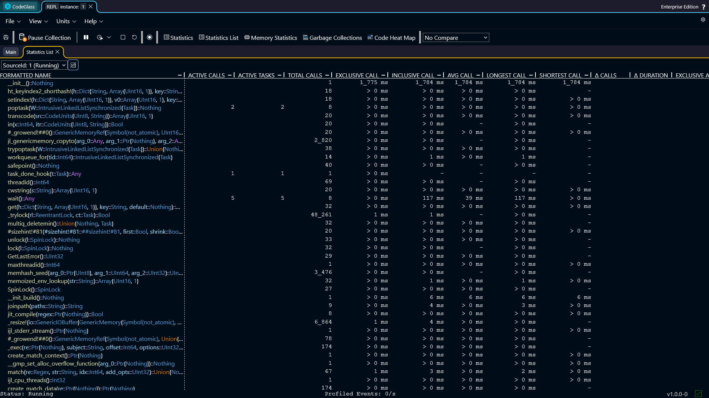

# Code Member List

The **code member list** view shows general statistics for all *code members* that were called during the run of your application.

*Code members* are shown in a long list without any grouping.

Double-clicking a [*code member*](./codemember) opens the *code member* view for that *code member*.

You can also click on any column in the table to sort the data by that statistic.

## Toolbar

Above the table there is a toolbar with several options:

- **Data Source**: select which [*data source*](../../concepts-and-features/datasources) the statistics should use.
- **Show/Hide uncalled code members**: Clicking this switches between all the registered *code members* and all the *code members* that have been executed in the selected *data source*. 

## Types of Statistics

The *code member* list contains several columns with statistics about the *code members* within the application.

- **Active Calls**: The number of active calls at this very moment.
- **Active Tasks**: The number of active tasks at this very moment.
- **Total Calls**: The total number of calls that happened in the selected *data source*.
- **Exclusive Call**: The call duration of this *code member*, excluding the time of the *code members* that get called inside of this *code member*.
- **Inclusive Call**: The call duration of this *code member*, including the time of the *code members* that get called inside of this *code member*.
- **Average Call**: The average call duration of this *code member*.
- **Longest Call**: The longest time a *code member* took to execute.
- **Shortest Call**: The shortest time a *code member* took to execute.
- **Δ Calls**: The amount of calls in the last second.
- **Δ Duration**: The sum of all call duration in the last second.
- **Exclusive Allocations**: The amount of allocations inside of this *code member*, excluding the allocations of the *code members* that get called inside of this *code member*.
- **Exclusive Deallocations**: The amount of deallocations inside of this *code member*, excluding the allocations of the *code members* that get called inside of this *code member*.
- **Δ Allocations**: The difference in exclusive allocated and deallocated objects.
- **Exclusive Allocated Bytes**: The amount of allocated bytes inside of this *code member*, excluding the allocated bytes of the *code members* that get called inside of this *code member*.
- **Exclusive Deallocated Bytes**: The amount of deallocated bytes inside of this *code member*, excluding the allocated bytes of the *code members* that get called inside of this *code member*.
- **Δ Allocated Bytes**: The difference in exclusive allocated and deallocated bytes.
- **Inclusive Allocations**: The amount of allocations inside of this *code member*, and all other *code members* inside.
- **Inclusive Allocated Bytes**: The amount of allocated bytes inside of this *code member*, and all other *code members* inside.

:::info
If [**memory profiling**](../general/settings#memory-profiling) is turned off, the columns with memory statistics will not be shown.
:::