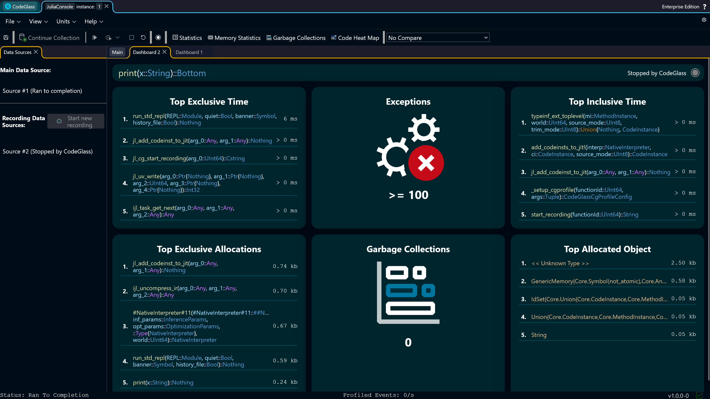
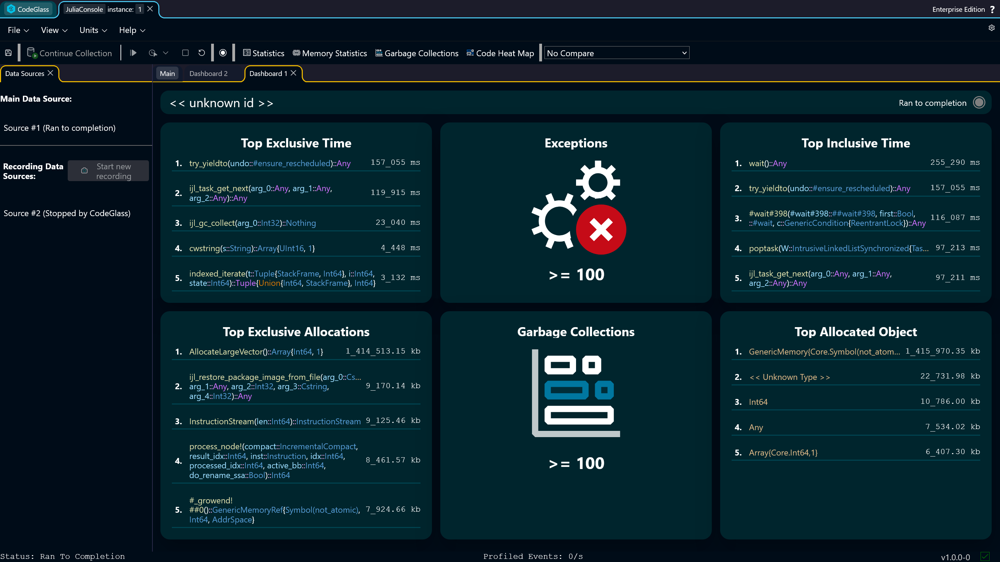

# Dashboard

The **Dashboard** shows a quick overview of the most interesting data of a [*data source*](../../concepts-and-features/datasources).

When creating recordings using the [@cgview](../../languages/Julia/codeglass-jl#cgview) or [@cgprofile](../../languages/Julia/codeglass-jl#cgview) macro, the name of the function that was profiled will be shown on top. For other *data sources* this will be shown as "\<\<unknown id>\>". The status of the *data source* is shown on the top right.
:::warning 
The entry function might show as not called in the *code member* view. This can happen due to inlining.
:::

## Statistics
The view is divided into **time** statistics at the top and **memory** statistics at the bottom.

### Time
* **Top Exclusive Time**: *Code members* sorted by the time spent in their own code. This is used for finding the *code members* that actually take up CPU time.
* **Exceptions**: The number of exceptions that occurred.
* **Top Inclusive Time**: *Code members* sorted by the time spent in their own code and the *code members* it calls. This is used for finding entry points for heavy execution paths. If the *data source* contains an entry or main *code member*, this will often show up on top of this list.

### Memory
* **Top Exclusive Allocations**: *Code members* sorted by how much memory was allocated in their own code. This is used for finding the *code members* that actually allocate the most memory.
* **Garbage Collections**: How many garbage collections occurred. Many garbage collections can point to high GC pressure due to many allocations, and contribute to longer execution times.
* **Top Allocated Object**: Objects sorted by how much memory was allocated for them. This is used to reveal what types contributed most to memory pressure.

:::note 
These statistics were selected as they often contain the most interesting profiling data. Your use case might differ, so [reach out](/contact) to us if you are missing some statistic here.
:::

