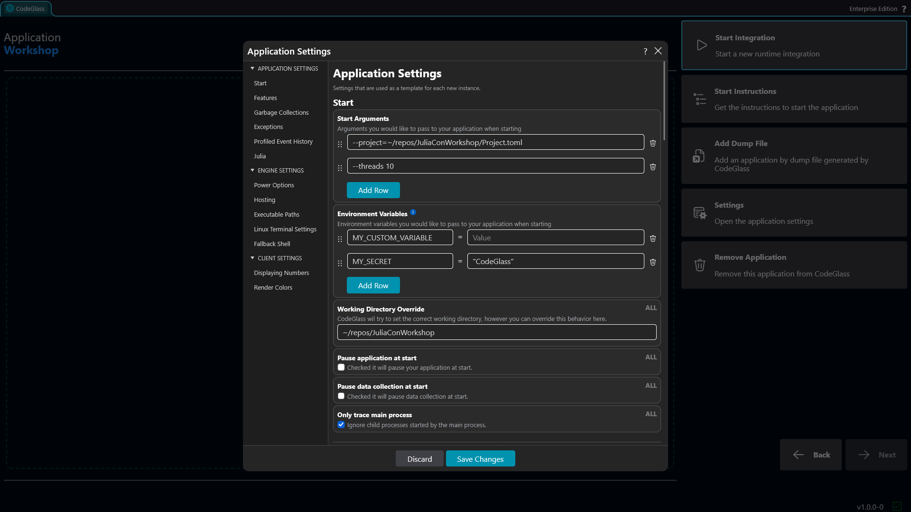

# Settings

In CodeGlass, there are three different levels of settings. First, you have the [global settings](./application-list#settings). These settings are used for every new application.

Next, the [application settings](./instance-list#settings) can be configured for each new instance created within that application.

Finally, you can view the [instance settings](../app-instance#settings-gear-icon) for each instance. These settings cannot be changed, as they are defined at startup.

Each setting lists the languages it supports. If an application does not support a setting, that setting is not shown in its application or instance settings.

## Agent

### Start

#### Start Arguments

Here you can set all the arguments that should be used when starting your application. You can place each argument on a separate row or place all arguments on one line.

You can see the command that will be used to start your application on the [start instructions](./instance-list#start-instructions) popup. Here you can validate that your arguments are applied correctly.

:::info
CodeGlass places the arguments in the start instructions in the order that you placed them on the settings screen. If the order is important, you can drag and drop each argument to the correct place using the 6 dots on the side.
:::

#### Environment Variables

Here you can set all the environment variables that should be set when starting your application. Each variable is placed on a separate row, with the left field destined for the name, and the right one for its value. CodeGlass will automatically add `export` in front of it when needed. Note that no input validation is performed on the name or value of the environment variable, meaning you might need to escape special characters.

You can see the command that will be used to start your application on the [start instructions](./instance-list#start-instructions) popup. Here you can validate that your variables are applied correctly.

You can also add [CodeGlass environment variables](../../languages/Julia/installation-and-usage#environment-variables) (such as `CG_PAUSE_DATA_COLLECTION_ON_START`) to the environment variables in the settings menu, but note that overriding `CG_TOKEN` may cause undefined behavior.

:::info
CodeGlass places the environment variables in the start instructions in the order that you placed them on the settings screen. If the order is important, you can drag and drop each variable to the correct place using the 6 dots on the side.
:::

#### Working Directory Override

CodeGlass will try to set its correct working directory, but this can be overridden by defining the path of your working directory.

#### Pause Application At Start

When enabled, your application will be paused at the start.

You can continue the application through the [toolbar](../app-instance#pause--continue-application) on the [instance screen](../app-instance).

#### Pause Data Collection On Start

When enabled, the agent will start with [**data collection paused**](../../concepts-and-features/pause-data-collection). No data is sent to the Engine until data collection is manually enabled again.

You can enable data collection through the [toolbar](../app-instance#pause--continue-data-collection) on the [instance screen](../app-instance).

You can also enable data collection through the builtin [CodeGlass Julia package](../../languages/Julia/codeglass-jl#pausecontinue-data-collection).

#### Only Trace Main Process

Languages such as Julia can spawn additional child processes, for example during precompilation.

By default, CodeGlass automatically profiles these child processes. This can slow down execution and create extra instances in the UI.

Enabling this option prevents CodeGlass from profiling child processes. If your application relies on them, leave this option disabled.

### Features

#### Memory Profiling

When enabled, the [Agent](../../intro#agent) will listen for memory allocation events and send this information to the Engine.

#### Include Deallocations

When enabled, the Agent will track garbage collection and deallocation events and send them to the Engine.

*This option is only available when Memory Profiling is enabled.*

### Garbage Collections

#### Maximum Garbage Collection History

This value controls how many garbage collections CodeGlass keeps in its history, as they can contain a large amount of data.

### Exceptions

#### Maximum Exceptions History

Exceptions can contain a lot of data. By setting this value, you tell CodeGlass how many exceptions it should keep stored in its history.

### Profiled Event History

#### Enable Realtime Renderers

When checked, it will start the data collection for the realtime renderers. This will decrease the speed at which CodeGlass can process data, and reserve a certain amount of [memory](#total-memory-reserved) to store this.

#### Reserved megabytes per exception

How many megabytes will be reserved per exception in the history. When an exception has not occured yet, this memory will be used for normal history.

*This option is only available when Realtime Renderers is enabled.*

#### Reserved megabytes for history

How many megabytes are reserved for the history.

*This option is only available when Realtime Renderers is enabled.*

#### Total memory reserved

This is a calculated field, that shows you how much memory CodeGlass reserves for the event history. The calculation is as follows: 

[Maximum exceptions history](#maximum-exceptions-history) * [reserved megabytes per exception](#reserved-megabytes-per-exception) + [reserved megabytes for history](#reserved-megabytes-for-history) + reserved megabytes for system.
The last added memory is required for the event history system to function, and is ~176mb.

:::note
This memory will only be claimed on your machine once the events actually occur and are stored in history.
:::

*This option is only available when Realtime Renderers is enabled.*

#### Total history duration

This is a calculated field, that shows you how much far back the history is kept for the amount of [reserved memory](#total-memory-reserved). This is calculated based on 1_000_000 events per second, so you can adjust it based on the actual event speed of your application. 

:::note
This number includes history duration for exceptions. If the exceptions happened outside of the normal history, the history you can step back to in the renderers will be shorter.
:::
:::note
Since we can't predict what events will occur, this is a worst case estimation. This means the true number will practically always be higher.
:::

*This option is only available when Realtime Renderers is enabled.*

### Julia

#### Julia Profile Preset Type

CodeGlass allows you to start Julia with multiple different profiling presets.
These presets are described [here](../../languages/Julia/codeglass-julia#julia-and-inlining).

### .NET

#### Enable All Code Optimizations

When checked, it will enable all code optimizations done by the runtime/compiler.

#### Enable All Function Inlining

When checked, it will enable all function inlining done by the runtime/compiler.

#### Experimental hooks

When checked, it will use experimental hooks.

## Engine

### Power Options

#### Automatic Engine Shutdown

When enabled, the Engine will shutdown when there are no active connections to Agents and Clients left.

#### Register Engine For Starting Through Browser

Whenever the Engine is shut down, attempting to log in via the browser will start it back up.

When enabled, a registry entry (Windows), a desktop entry (Linux), or an app bundle (macOS) will be created.  
When disabled, the registry entry (Windows), the desktop entry (Linux), or the app bundle (macOS) will be removed.  

### Hosting

#### Serve Client Over HTTPS

By default, the [Client](../../intro#client) is served over HTTP and is only accessible from the same machine. This is because a signed certificate is required to serve content over HTTPS.

If you want to connect remotely to the Engine, you need to enable HTTPS with this setting. This change will take effect the next time the [Engine](../../intro#engine) is started and will cause the browser to display a warning prompting the user to accept the self-signed certificate.

:::warning
When you enable this option, CodeGlass generates a self-signed certificate. Depending on your computer (network) settings you may need to do more configuration to allow other computers to access your computer from the network.

These are not CodeGlass specific and you should only do them if you know what you are doing as this may impact the security of your device.
:::

:::info
If you disable this option, CodeGlass will automatically remove the self-signed certificate the next time you restart the Engine.
:::

### Executable Paths

#### Julia

The path to the CodeGlass Julia executable.   
This path will be used to start Julia applications from the [Engine](../../intro#engine). It is also used to determine the start instructions of a Julia application.

### Linux Terminal Settings

On Linux, when you start a new Julia instance by clicking [Start Integration](../general/instance-list#start-integration), it tries to start Julia in the terminal that the [Engine](../../intro#engine) is running in.
This is not expected behavior, you want the Julia instance to open in a new terminal. Linux has the problem that there is no way of finding or using a default terminal. 
These settings can be used to configure your terminal to use.

#### Terminal Command

The actual command to start your terminal, like:
- gnome-terminal
- konsole
- xterm
- alacritty
- kitty

#### Terminal Argument Command

The argument needed to execute a command when calling the terminal.

For the examples above:
- gnome-terminal: --
- konsole: -e
- xterm: -e
- alacritty: -e
- kitty: -e

### Fallback Shell

#### Use PowerShell As Fallback Shell

Set if CodeGlass should use PowerShell as fallback shell if no default system shell could be used to launch an application.

When you click on the [Start Integration](../general/instance-list#start-integration) button, the [Engine](../../intro#engine) tries to start you application in a new shell instance.
For terminal based applications, like Julia, this can have the problem that it starts in the same shell as the Engine was started in (as the system sees it as a child process). 

This problem can be solved, by starting a new instance of your shell, and running the application in there. 
But there is no native cross-platform way of starting a new shell. To fix the issue, CodeGlass ships with PowerShell build in.
When CodeGlass could not start an instance of your native shell, and this option is enabled, CodeGlass starts a PowerShell and starts your application in there.
If this option is disabled, CodeGlass will still try and start your application, but it might start in in the same shell as the Engine is currently running.

## Client

### Displaying Numbers

#### Separator Character
Here you can define the character that CodeGlass should use to separate thousands. (Ex. 1.000 or 1_000)

#### Decimal Character
Here you can define the character that CodeGlass should use to separate decimal values. (Ex. 1.0 or 1,0)

### Render Colors
Here you can configure what colors some of the render screens should use to visualize data. The render screens in CodeGlass often show a gradation of performance using two colors. 
By default this is a gradation between green (for the best value) and red (for the worst values). CodeGlass automatically calculates the color gradients based on a values percentage relative to the best performing value.

#### Start Color
The color CodeGlass should use for the 'worst' values.

#### End Color
The color CodeGlass should use for the 'best' values.